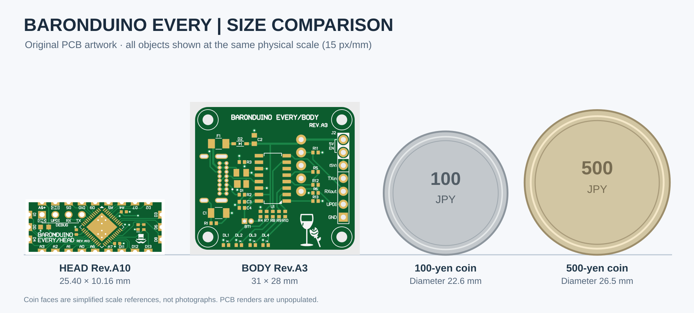
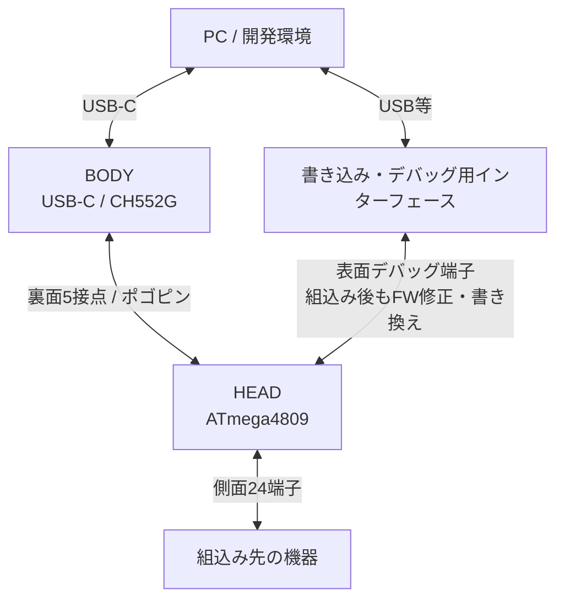
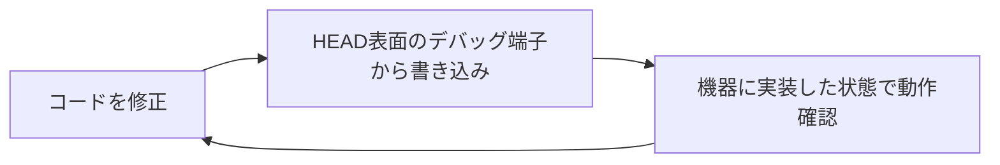

# BARONDUINO EVERY

### Born to be Embedded.
**「組み込み」ではなく、「埋め込み」。**

Arduino Nanoでも、まだ大きすぎる。

小さな電子工作や機器の内部にマイコンを入れようとすると、USBコネクタや書き込み回路、開発時にしか使わない部分が、完成品の中でも場所を占め続けます。マイコンそのものはもっと小さくできるのに、開発のための仕組みまで一緒に残さなければならないのでしょうか。

BARONDUINOは、その疑問から生まれました。

目指したのは、単に小さなArduino互換ボードではありません。**回路の中に、存在を意識させずに「埋め込める」マイコン**です。

## 実寸比較 — 100円玉・500円玉と並べる

*HEAD/BODYは実際の基板PNGを使用し、硬貨は寸法比較用の模式図です。すべて同じ縮尺（15 px/mm）で配置しています。*

## なぜ、HEADとBODYに分けたのか

BARONDUINO EVERYでは、機器に残すマイコン本体を **HEAD**、開発時に使うUSBインターフェースを **BODY** として分離しました。

- **HEAD** は、ATmega4809を搭載した **25.40 × 10.16 × 0.8 mm** の細長い基板。機器に必要なマイコンと接続端子を凝縮しました。
- **BODY** は、USB-CとCH552Gを備えた開発用インターフェース。HEADとポゴピンで接続して使用する設計です。

開発用の回路を、すべての完成品に持たせる必要はありません。必要なときに使い、不要になれば切り離せる。それがHEAD/BODYという構成です。

**書き込み経路は2つあります。** 開発時のBODY経由に加え、機器に組み込んだ後もHEAD表面のデバッグ端子からファームウェアを修正・書き換えできます。図中のデバッグ用インターフェースは機能上の概念であり、具体的な対応機器・接続方法は検証後に公開します。

*構成の概念図です。実際の基板形状・配置を示す図ではありません。*

## 埋め込んだら終わり、ではない

ここはBARONDUINO EVERYの重要な特徴です。

**HEADは機器に埋め込んだ後も、表面のデバッグ端子を使ってファームウェアを書き換えられる設計です。**

つまり、「組込み前に最終版のファームウェアを書き込んで、それで完成」という一方通行ではありません。**機器に実装したまま、プログラムを修正し、書き換え、動作を確認し、また修正する**。そんな開発サイクルを想定しています。

HEADには、用途の異なる3つの接続手段があります。

| 接続箇所 | 役割 |
| --- | --- |
| **側面24端子** | 機器の回路へ埋め込むための入出力 |
| **裏面5接点** | BODYとの接続 |
| **表面デバッグ端子（4端子）** | **組込み後も含めた、ファームウェアの書き換え・開発・検証** |

表面デバッグ端子はGND / UPDI / RX / TXの4端子（2.54 mmピッチ）。組込み後に利用する場合は、機器側で端子へのアクセスを確保する必要があります。具体的な接続方法と書き込み手順は検証後に公開します。

**小さく埋め込めることと、埋め込んだ後も開発を続けられること。その両方を目指しています。**

## BARONDUINOからBARONDUINO EVERYへ

BARONDUINOは、Arduino Nanoでも大きすぎる用途に向けて始まった超小型Arduino互換ボードの試みです。

その考え方を受け継ぎ、ATmega4809を採用したのが **BARONDUINO EVERY**。Arduino Nano Everyのソフトウェア資産を活用できる互換性を目標に、HEADとBODYを分離した構成を追求しています。

「小さなArduinoを作る」ことが目的ではありません。**使いたい機器の大きさや形を、マイコンボードに決めさせない**ことが目的です。

## Hardware at a glance

| 項目 | HEAD Rev.A10 | BODY Rev.A3 |
| --- | --- | --- |
| 主なIC | ATmega4809 | CH552G |
| 基板寸法 | **25.40 × 10.16 × 0.8 mm** | 31 × 28 × 1.6 mm |
| 主な接続 | 側面24端子、裏面5接点、表面デバッグ4端子 | USB-C、ポゴピン5点 |
| 役割 | 組込み・実装後の開発と更新 | USB接続による開発支援 |

詳細は[ハードウェア仕様](hardware/README.md)をご覧ください。

## PCB Business Card — 名刺も基板に

BARONDUINO EVERYの考え方を、手に取れる形で紹介するための**PCB名刺**も設計しました。

一枚の名刺基板に、切り離せるHEADとBODYを収め、QRコードとNFCタグを組み合わせています。名刺をきっかけにこのリポジトリを訪れた方が、製品の考え方から技術仕様、組立情報まで辿れる構成です。

個人情報を含む実際の名刺券面や製造データは、ここでは公開していません。

- [PCB名刺の紹介](business-card/README.md)
- [組立ガイド](business-card/assembly.md)
- [主要部品表](business-card/bom.md)
- [NFCとLEDの仕組み](business-card/nfc.md)

名刺のQRコード・NFCタグのリンク先：**https://github.com/ymmtynk/BARONDUINO_EVERY**

## Documentation

- [HEAD / BODY：ハードウェア仕様](hardware/README.md)
- [ソフトウェア・書き込み](software/README.md)
- [PCB Business Card](business-card/README.md)

## 開発状況

本リポジトリは資料整備中です。掲載している基板仕様は設計資料に基づき、実機評価前の項目を含みます。Arduino IDEの設定、BODYのファームウェア、書き込み手順、組込み後のデバッグ端子の使用方法は、検証に合わせて公開します。

## Trademarks / 商標について

The NFC Forum Wayfinding Marks is a registered trademark owned by the NFC Forum, Inc.

Arduino is a trademark of Arduino S.r.l.

NFC Forum Wayfinding Markの帰属表示と使用ライセンスは別の要件です。マークの使用は本製品がNFC Forum Certifiedであることを意味しません。
