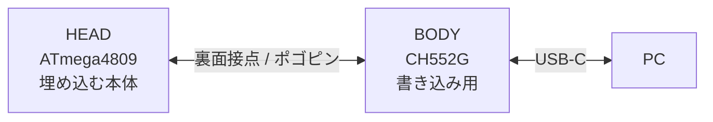

# BARONDUINO EVERY

## BARONDUINO EVERYを図で見る

### Born to be Embedded.
**組み込みから、埋め込みへ。**

Arduino Nanoでも大きすぎる。そんな場所に、マイコンを「埋め込む」ために。

BARONDUINO EVERYは、ATmega4809を搭載した超小型Arduino互換マイコンボードです。プログラムを書き込むための回路を常時搭載するのではなく、実際に機器へ組み込む **HEAD** と、開発・書き込み時に使う **BODY** に分離しました。

> **Born to be Embedded.** — 「組み込み」ではなく「埋め込み」。

## 構成

| | HEAD | BODY |
| --- | --- | --- |
| 役割 | 機器に埋め込むマイコン本体 | 開発・書き込み用 |
| 主なIC | ATmega4809 | CH552G |
| 接続 | 24個の側面端子・5個の裏面接点 | USB-C・ポゴピン |
| 特徴 | 必要最小限の部品構成 | USB通信・SerialUPDI |

**HEAD基板寸法は25.40 × 10.16 × 0.8 mm（Rev.A10）**。24個の側面端子を備えた細長い基板です。

**HEADは機器に埋め込んだ後も、表面のデバッグ端子からアクセスしてプログラムを書き換えられる設計です。** 開発時だけでなく、組込み後の更新・保守にも対応することを重視しています。

Arduino Nano Everyのソフトウェア資産を活用できる互換性を目指しています。ボード設定・書き込み手順は検証後に掲載します。

## Documentation / 資料

- [HEAD / BODY の概要と仕様](hardware/README.md)
- [ソフトウェア・書き込み](software/README.md)
- [PCB Business Card — 基板名刺](business-card/README.md)

## PCB Business Card

**A business card that is also a circuit board.**

BARONDUINO EVERYのHEADとBODYを、切り離せる形で一枚のPCB名刺に収めました。QRコードとNFCタグを備え、部品未実装で受け取った方向けの製作資料も用意しています。

[名刺の紹介](business-card/README.md) · [組立ガイド](business-card/assembly.md) · [部品表](business-card/bom.md) · [NFCの説明](business-card/nfc.md)

**名刺のQRコードとNFCタグのリンク先はこのリポジトリです。** https://github.com/ymmtynk/BARONDUINO_EVERY

## 開発状況

資料整備中です。回路・部品表は設計リビジョンに基づくもので、試作評価前の項目を含みます。実装・書き込み前に最新の確認事項をご覧ください。

## Trademarks / 商標について

The NFC Forum Wayfinding Marks is a registered trademark owned by the NFC Forum, Inc.

Arduino is a trademark of Arduino S.r.l.

NFC Forum Wayfinding Markの帰属表示と使用ライセンスは別の要件です。マークの使用は本製品がNFC Forum Certifiedであることを意味しません。
