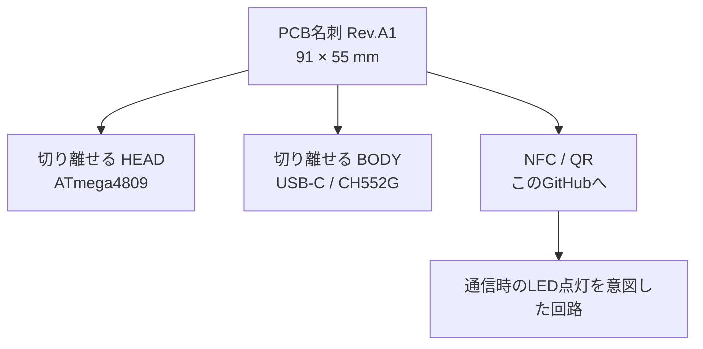
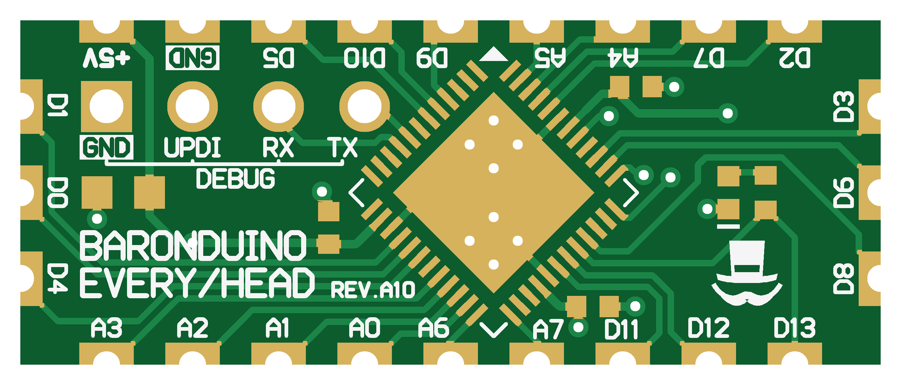
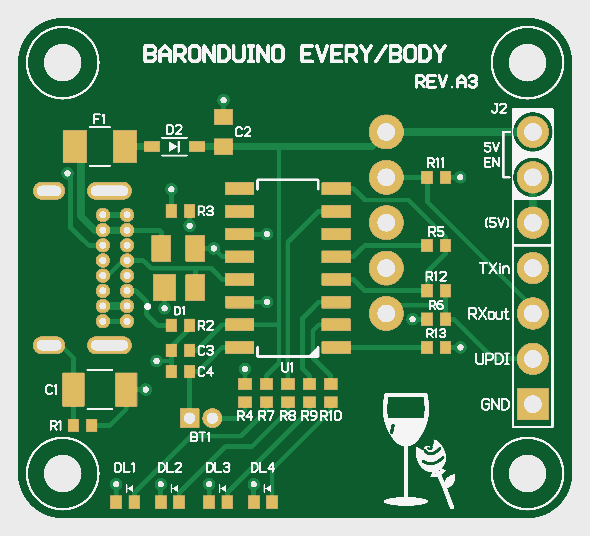

# BARONDUINO EVERY PCB Business Card

## 名刺の構成（個人情報を含まない模式図）

**A business card that is also a circuit board.**

BARONDUINO EVERYの設計思想を、一枚のプリント基板に凝縮したPCB名刺です。切り離せるHEADとBODY、QRコード、NFCタグ、LEDを備えています。

## 切り離して使う基板

**HEAD（Rev.A10）**

**BODY（Rev.A3）**

*これらは単体基板の設計PNGであり、名刺券面の切り出しではありません。表示倍率はそれぞれ異なります。*

## 構成 — Rev.A1（設計資料）

- 外形: 91 × 55 mm、角R2.5 mm、FR-4、厚さ0.8 mm、2層
- 仕上げ: マットブラックのソルダーレジスト、白色シルク、ENIG（金色の露出銅箔）
- HEAD: Rev.A10、BODY: Rev.A3
- NFC: NT3H2111（NTAG I²C plus 1k）、基板パターンアンテナ
- LED: NFCの電界から得られる電力を利用し、通信時の点灯を意図した回路

**NFCの共振調整・LED電流・通信時の点灯は試作確認が必要です。**

## 製作資料

- [組立ガイド](assembly.md)
- [部品表](bom.md)
- [NFCの仕様と設定](nfc.md)

名刺は部品未実装でも配布されます。部品実装には微細な表面実装部品（0402、0.4 mmピッチQFN等）の作業経験・設備が必要です。

## プライバシーと公開範囲

個人情報を含む名刺全体の画像・製造用Gerberはここでは公開していません。資料の追加時も個人情報の混入に注意します。

## Trademarks

The NFC Forum Wayfinding Marks is a registered trademark owned by the NFC Forum, Inc.

Arduino is a trademark of Arduino S.r.l.
