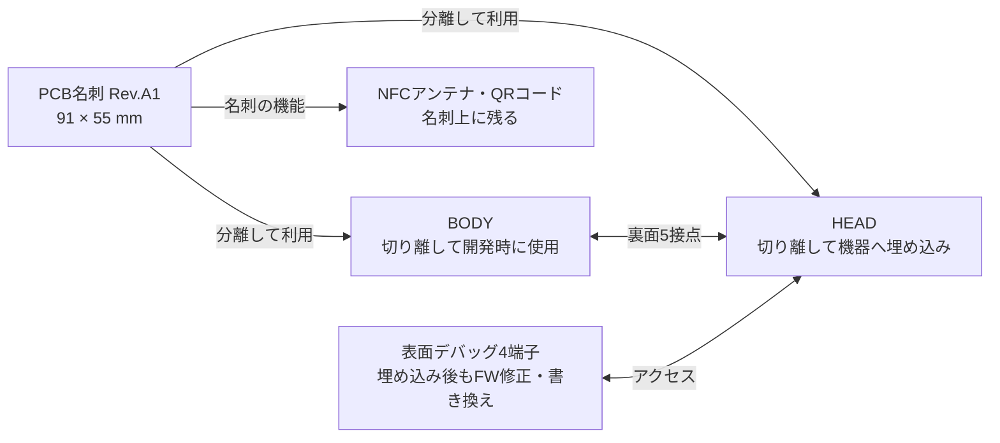

# BARONDUINO EVERY PCB Business Card

## 名刺の構成

**名刺そのものが、切り離して使える電子回路。**

一枚のPCB名刺に、マイコン本体のHEAD、開発用インターフェースのBODY、NFCアンテナとQRコードを組み込んだ設計です。

*配置や切り離し位置を表す製造図ではありません。HEADの表面デバッグ端子は、埋め込み後のファームウェア修正・書き込みにも利用する設計です。*

## 実際の基板とサイズ感

*基板は設計データから出力したPNG、硬貨は直径に基づく模式図です。すべて同一縮尺で比較しています。名刺の個人情報を含む券面は掲載していません。*

**A business card that is also a circuit board.**

BARONDUINO EVERYの設計思想を、一枚のプリント基板に凝縮したPCB名刺です。切り離せるHEADとBODY、QRコード、NFCタグ、LEDを備えています。

## 構成 — Rev.A1（設計資料）

- 外形: 91 × 55 mm、角R2.5 mm、FR-4、厚さ0.8 mm、2層
- 仕上げ: マットブラックのソルダーレジスト、白色シルク、ENIG（金色の露出銅箔）
- HEAD: Rev.A10、BODY: Rev.A3
- NFC: NT3H2111（NTAG I²C plus 1k）、基板パターンアンテナ
- LED: NFCの電界から得られる電力を利用し、通信時の点灯を意図した回路

**NFCの共振調整・LED電流・通信時の点灯は試作確認が必要です。**

## 製作資料

- [組立ガイド](assembly.md)
- [部品表](bom.md)
- [NFCの仕様と設定](nfc.md)

名刺は部品未実装でも配布されます。部品実装には微細な表面実装部品（0402、0.4 mmピッチQFN等）の作業経験・設備が必要です。

## カスタムPCB名刺という可能性

名刺の氏名・所属・連絡先などの表示内容を差し替え、HEAD・BODY・NFCの共通設計を活かした個別仕様のPCB名刺も構想できます。ただし、**現時点で受注製作サービスを提供しているという案内ではありません**。製作条件・費用・権利関係・個人情報の取り扱いは別途検討が必要です。

## プライバシーと公開範囲

個人情報を含む名刺全体の画像・製造用Gerberはここでは公開していません。資料の追加時も個人情報の混入に注意します。

## Trademarks

The NFC Forum Wayfinding Marks is a registered trademark owned by the NFC Forum, Inc.

Arduino is a trademark of Arduino S.r.l.
