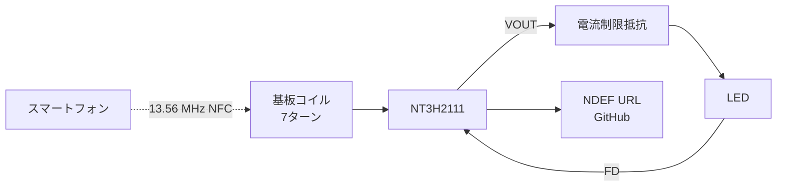

# NFC / LED — PCB Business Card Rev.A1

## 動作の概念図

## 仕組み

- NFC IC: **NXP NT3H2111W0FHKH**（NTAG I²C plus 1k、NFC Forum Type 2 Tag）
- アンテナ: 基板裏面の7ターンコイル。設計値は線幅/間隔0.20/0.20 mm、推定約2.8 µH
- N_C1: 220 nF、VOUT–GND間
- N_C2: アンテナ調整用パッド（通常DNP）
- LED: VOUT → N_R1 → N_D1 → FDの構成
- N_R1: 約330 Ωの暫定値。LED電流と点灯は実機評価で決定
- 金色のネームラインはLEDカソード側の配線を兼ねています

FDを通信開始時に反応させる設定を意図しています。**設定値・共振・動作は実機での検証が必要です。**

## タグに書き込むURL

**https://github.com/ymmtynk/BARONDUINO_EVERY**

このURLは名刺のQRコードと共通です。**リポジトリ名・URLを変更しないでください。**

## 商標・ライセンス

The NFC Forum Wayfinding Marks is a registered trademark owned by the NFC Forum, Inc.

NFC Forum Wayfinding Markの使用には、適用される使用ライセンスの確認が必要です。帰属表示だけでライセンス条件を満たすわけではありません。

公式情報: https://nfc-forum.org/build/branding/

マークの表示は、名刺がNFC Forum Certifiedであることを意味しません。

Arduino is a trademark of Arduino S.r.l.
