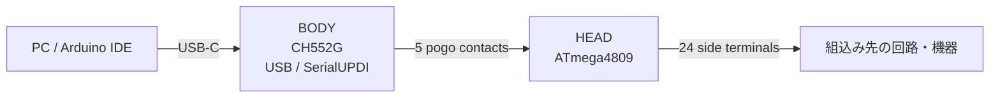
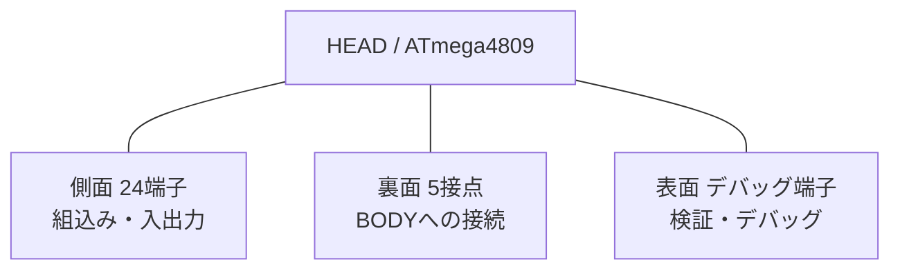

# Hardware — HEAD / BODY

**設計資料に基づく概要（試作検証前の項目を含みます）**

## システム構成

*機能を示す概念図です。寸法・端子位置を示す製造図ではありません。*

## HEAD — Rev.A10

- MCU: Microchip ATmega4809、VQFN-48、6 × 6 mm、0.4 mmピッチ
- 電源: 5 V
- **側面端子: 24端子** — 組込み先との接続
- **裏面接点: 5点** — BODYのポゴピンと接続（+5V、RX、TX、GND、UPDI）
- **表面デバッグ端子** — 開発・検証用のアクセス端子（裏面のBODY接点とは別）
- 設計資料のデバッグヘッダ: J2、1×4、GND / UPDI / DBG_RX / DBG_TX（通常未実装）
- LED: D13経由

### HEADの端子の役割

*概念図です。表面デバッグ端子の実際の位置・形状・ピン配置は基板レイアウト図で確認してください。*

## BODY — Rev.A3

- CH552GによるUSB通信・SerialUPDIインターフェース
- USB Type-C
- 5個のポゴピンによるHEAD接続
- 基板寸法: 31 × 28 × 1.6 mm（設計資料）
- PWR / HEAD / PROG / MON表示LED

HEADとBODYの端子接続・書き込み方法は、ファームウェアと実機の確認後に詳細を掲載します。

## PCB名刺

[基板名刺の詳細](../business-card/README.md)をご覧ください。

**注記**：設計データは更新される場合があります。製造・実装の前にリビジョンを確認してください。
