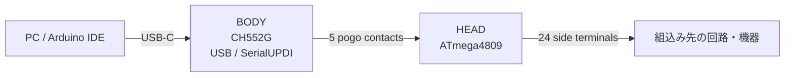
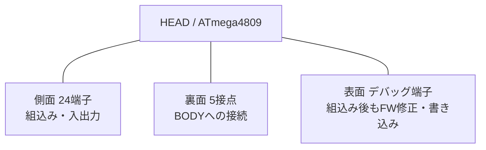

# Hardware — HEAD / BODY

**設計資料に基づく概要（試作検証前の項目を含みます）**

## システム構成

*機能を示す概念図です。寸法・端子位置を示す製造図ではありません。*

## HEAD — Rev.A10

- **基板外形: 25.40 × 10.16 mm、厚さ0.8 mm（FR-4、2層）**
- MCU: Microchip ATmega4809、VQFN-48、6 × 6 mm、0.4 mmピッチ
- 電源: 5 V
- **側面端子: 24端子** — 組込み先との接続
- **裏面接点: 5点** — BODYのポゴピンと接続（+5V、RX、TX、GND、UPDI）
- **表面デバッグ端子** — 開発・検証に加え、**HEADを機器に埋め込んだ後もプログラムを書き換えるためのアクセス端子**（裏面のBODY接点とは別）
- 設計資料の表面デバッグ端子: J2、4つのスルーホール、2.54 mmピッチ、GND / UPDI / DBG_RX / DBG_TX（ヘッダ部品は通常未実装）
- LED: D13経由

### HEADの端子の役割

*概念図です。表面デバッグ端子の実際の位置・形状・ピン配置は基板レイアウト図で確認してください。*

## BODY — Rev.A3

- CH552GによるUSB通信・SerialUPDIインターフェース
- USB Type-C
- 5個のポゴピンによるHEAD接続
- 基板寸法: 31 × 28 × 1.6 mm（設計資料）
- PWR / HEAD / PROG / MON表示LED

## 組込み後も続けられるファームウェア開発

HEADは機器に埋め込んだ後も、**表面のデバッグ端子を使ってファームウェアの修正・書き込みを繰り返せる設計**です。組込み前に最終ファームウェアを確定させる必要はなく、実装状態でコード修正→書き込み→動作確認を繰り返す開発を想定しています。BODYとの着脱を前提とした裏面5接点とは別に、実装状態での更新・保守に使えるアクセス手段を設けています。

実際にアクセスできるかどうかは、組込み先の筐体・実装方法で表面端子を利用可能にしておく必要があります。接続方法と書き込み手順は実機確認後に詳述します。

HEADとBODYの端子接続・書き込み方法は、ファームウェアと実機の確認後に詳細を掲載します。

## PCB名刺

[基板名刺の詳細](../business-card/README.md)をご覧ください。

**注記**：設計データは更新される場合があります。製造・実装の前にリビジョンを確認してください。
