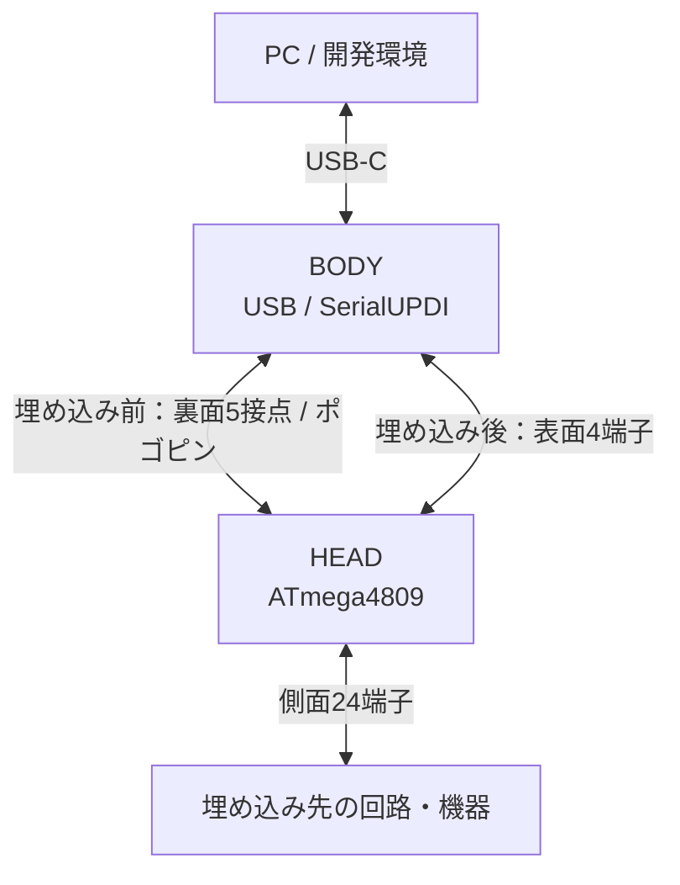
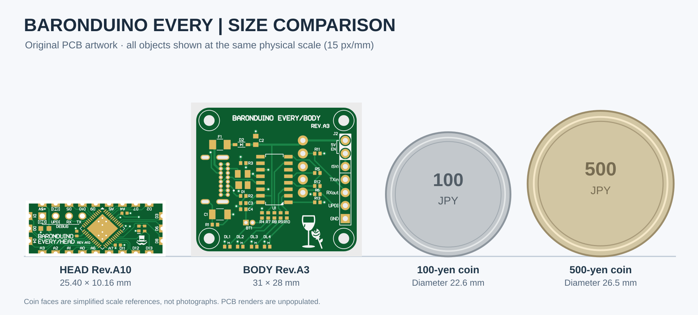
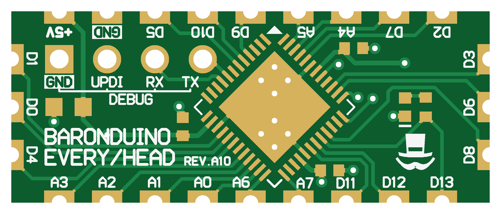
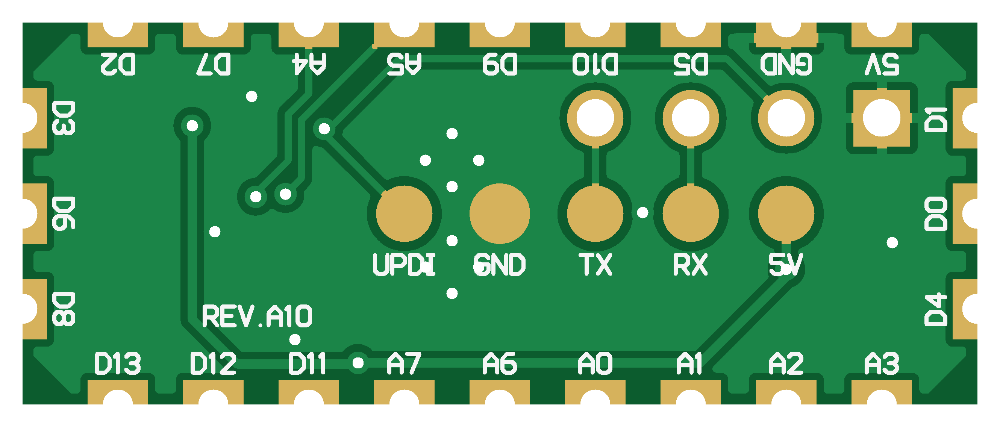
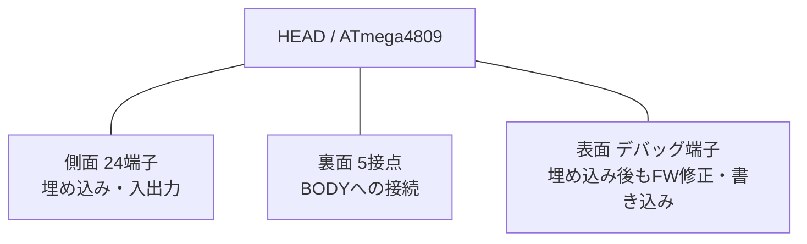
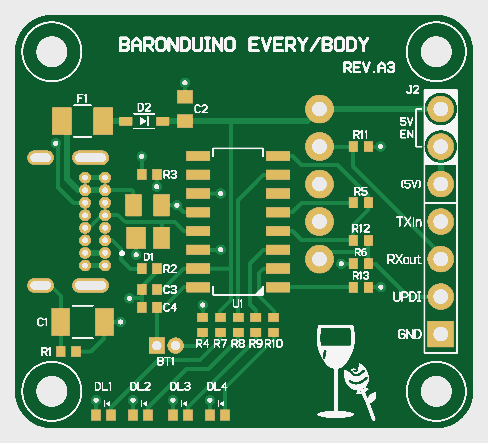

# Hardware — HEAD / BODY

**設計資料に基づく概要（試作検証前の項目を含みます）**

## システム構成

**HEADは、埋め込み前には裏面5接点、埋め込み後には表面4端子を介して同じBODYに接続でき、ファームウェアの書き込み・更新を継続できます。**

*機能を示す概念図です。寸法・端子位置を示す製造図ではありません。*

## 実寸比較 — 100円玉・500円玉と並べる

*HEAD/BODYは実際の基板PNGを使用し、硬貨は寸法比較用の模式図です。すべて同じ縮尺（15 px/mm）で配置しています。*

## HEAD — Rev.A10

| 表面：デバッグ4端子 | 裏面：BODY接続用5接点 |
| :---: | :---: |
|  |  |

*いずれもRev.A10の設計データから出力した未実装基板のPNGです。名刺の券面画像は使用していません。*

- **基板外形: 25.40 × 10.16 mm、厚さ0.8 mm（FR-4、2層）**
- MCU: Microchip ATmega4809、VQFN-48、6 × 6 mm、0.4 mmピッチ
- 電源: 5 V
- **側面端子: 24端子** — 埋め込み先との接続
- **裏面接点: 5点** — BODYのポゴピンと接続（+5V、RX、TX、GND、UPDI）
- **表面デバッグ端子** — 開発・検証に加え、**HEADを機器に埋め込んだ後もプログラムを書き換えるためのアクセス端子**（裏面のBODY接点とは別）
- 設計資料の表面デバッグ端子: J2、4つのスルーホール、2.54 mmピッチ、GND / UPDI / DBG_RX / DBG_TX（ヘッダ部品は通常未実装）
- LED: D13経由

### HEADの端子の役割

*概念図です。表面デバッグ端子の実際の位置・形状・ピン配置は基板レイアウト図で確認してください。*

## BODY — Rev.A3

*Rev.A3の未実装基板レンダリングです。*

- CH552GによるUSB通信・SerialUPDIインターフェース
- USB Type-C
- 5個のポゴピンによるHEAD接続
- 基板寸法: 31 × 28 × 1.6 mm（設計資料）
- PWR / HEAD / PROG / MON表示LED

## 埋め込み後も続けられるファームウェア開発

HEADは機器に埋め込んだ後も、**同じBODYを表面4端子に接続してファームウェアの修正・書き込みを繰り返せる設計**です。埋め込み前は裏面5接点とポゴピンで接続し、埋め込み後は表面4端子を利用します。最終ファームウェアを事前に確定させる必要はなく、コード修正→書き込み→動作確認を繰り返す開発を想定しています。

実際にアクセスできるかどうかは、埋め込み先の筐体・実装方法で表面端子を利用可能にしておく必要があります。接続方法と書き込み手順の詳細は実機確認後に掲載します。

HEADとBODYの端子接続・書き込み方法は、ファームウェアと実機の確認後に詳細を掲載します。

## PCB名刺

[基板名刺の詳細](../business-card/README.md)をご覧ください。

**注記**：設計データは更新される場合があります。製造・実装の前にリビジョンを確認してください。
